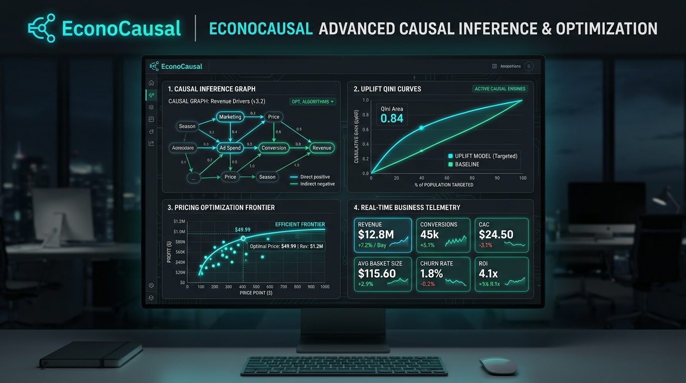
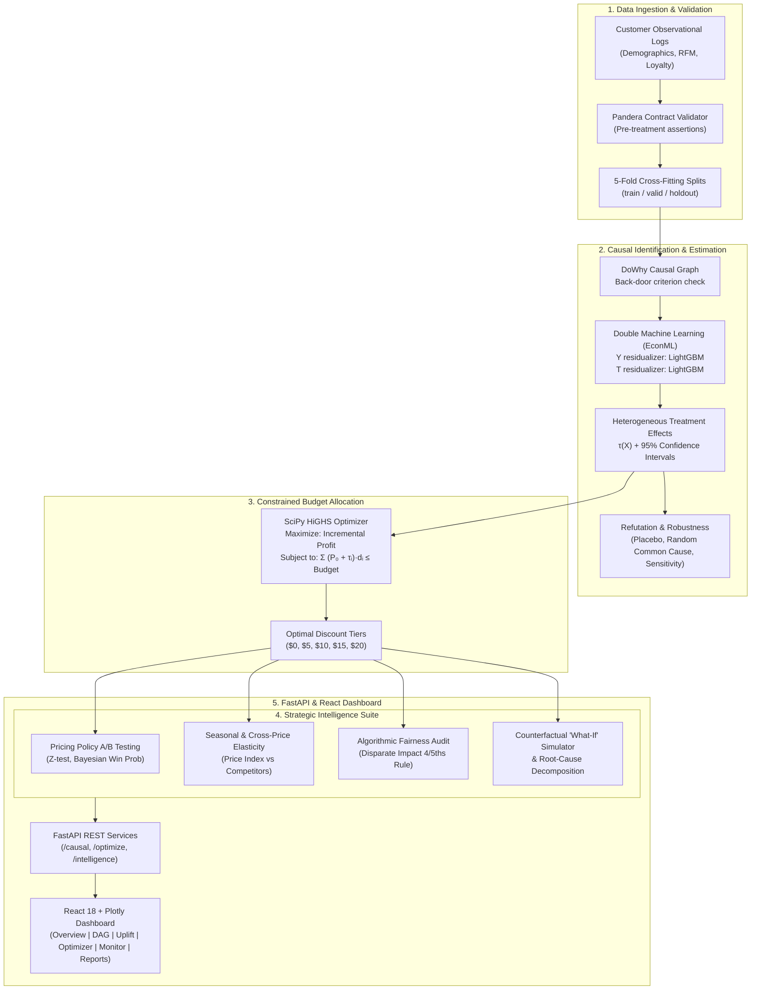

<div align="center">


# EconoCausal
### Enterprise Causal-AI Dynamic Pricing & Budget Allocation Engine/

[](https://python.org)
[](https://fastapi.tiangolo.com)
[](https://react.dev)
[](https://www.typescriptlang.org)
[](https://econml.azurewebsites.net)
[](https://py-why.github.io/dowhy)
[](https://scipy.org)
[](https://lightgbm.readthedocs.io)
[](https://github.com/astral-sh/ruff)
[](https://mypy.readthedocs.io)
[](LICENSE)

<br/>

**EconoCausal** resolves the fundamental question of promotion economics:  
> *"Would this specific customer buy **only if** we grant them a discount?"*

By unifying **Double / Debiased Machine Learning (DML)** with **causal DAG refutation** and **constrained mathematical programming (SciPy HiGHS)**, EconoCausal isolates individual treatment effects from confounded observational history and prescribes optimal, budget-compliant discount policies.

[Quick Start](#-quick-start) • [System Architecture](#-system-architecture) • [Causal Methodology](#-causal-methodology) • [Strategic Intelligence](#-strategic-intelligence-suite) • [Benchmark Results](#-benchmark-results) • [API Contract](#-api-endpoints)

</div>

---

<div align="center">
  
</div>

---

## ⚡ Executive Summary

Traditional predictive models forecast $P(\text{Purchase} \mid X, \text{Discount})$, invariably targeting customers with high baseline purchase intent (*"Sure Things"*). This burns promotional margin without producing incremental sales. 

EconoCausal targets the **Individual Treatment Effect ($\tau_i$)**:
$$\tau_i(d) = \mathbb{E}[Y_i(d) - Y_i(0) \mid X_i]$$

```
                   ╔═══════════════════════════════════════════════════════╗
                   ║              THE 4 CUSTOMER ARCHETYPES               ║
                   ╚═══════════════════════════════════════════════════════╝
                         Buys Without Discount      Buys With Discount
                         ─────────────────────      ──────────────────
  [PERSUADABLE]  🎯               NO                       YES          ──▶ Target (Maximize ROI)
  [SURE THING]   💰              YES                       YES          ──▶ Skip (Preserve Margin)
  [LOST CAUSE]   🛑               NO                        NO          ──▶ Skip (Zero Conversion)
  [SLEEPING DOG] ⚠️              YES                        NO          ──▶ Strict Never-Target
```

### Business Impact
- **Eliminate Promotional Deadweight**: Automatically suppress discounts for organic buyers.
- **Budget-Bounded Allocation**: Solves mixed-integer and linear programs to allocate capital under strict global budget constraints $B$.
- **Audit-Proof Identification**: Enforces structural unconfoundedness via DoWhy DAGs and validates robustness against unobserved confounding via sensitivity analysis.
- **Fair Pricing Governance**: Audits all automated pricing decisions against the regulatory **4/5ths (80%) Disparate Impact Ratio (DIR)** rule across customer tenure and demographic cohorts.

---

## 🛠️ Technology Stack

| Category | Primary Technologies & Libraries | Key Responsibilities |
|---|---|---|
| **Causal Inference** | `EconML 0.15.1`, `DoWhy 0.11.1` | Double ML (`CausalForestDML`, `LinearDML`), nuisance orthogonalization, DAG back-door adjustment, placebo refutations |
| **Nuisance Learning** | `LightGBM 4.3+`, `scikit-learn 1.5+` | Residualization of outcomes $Y$ and treatments $T$ using 5-fold cross-fitting ($K \ge 5$) |
| **Mathematical Optimization** | `SciPy 1.13+` (`linprog`, `milp` with HiGHS) | Constrained linear / mixed-integer knapsack optimization under fixed marketing budget $B$ |
| **Statistical Analysis** | `statsmodels 0.14+`, `numpy 1.26+`, `pandas 2.2+` | Two-proportion Z-tests, Beta-Binomial Bayesian win probabilities, cross-price elasticity regressions |
| **API Backend** | `FastAPI 0.111+`, `pydantic v2`, `uvicorn` | High-throughput asynchronous REST API, strict request/response validation, streaming background workers |
| **Frontend UI** | `React 18.3`, `TypeScript 5.6`, `Vite 6` | Dark-mode telemetry dashboard, responsive data grids, interactive sliders, executive PDF export |
| **Visualization** | `Plotly.js 2.35`, `Lucide React` | Interactive Qini curves, causal DAG graphs, optimization frontiers, sensitivity contours |
| **Quality & CI/CD** | `Ruff`, `Mypy (Strict)`, `pytest-cov`, `Hypothesis` | Zero-lint standard, 100% strict type hints, 85%+ core test coverage, property-based testing |

---

## 📐 System Architecture



---

## 🔬 Causal Methodology & Theory

### 1. The Confounding Challenge
In historical e-commerce logs, discount assignment $T$ is heavily confounded by customer attributes $X$ (e.g., lapsed high-value customers receive larger coupons). A naive regression of purchase $Y$ on discount $T$ severely underestimates or overestimates true elasticity.

### 2. Robinson's Orthogonalized Transformation
EconoCausal employs Double Machine Learning with Neyman orthogonality to achieve parametric rate $\sqrt{N}$ convergence on treatment effects even when using non-parametric ML models for nuisance components:

1. **Outcome Nuisance**: Model $\hat{q}(X) = \mathbb{E}[Y \mid X]$ via 5-fold cross-fitting. Residual: $\tilde{Y} = Y - \hat{q}(X)$.
2. **Treatment Nuisance**: Model $\hat{e}(X) = \mathbb{E}[T \mid X]$ via 5-fold cross-fitting. Residual: $\tilde{T} = T - \hat{e}(X)$.
3. **Causal Stage**: Regress $\tilde{Y}$ on $\tilde{T}$ interacting with customer features $X$:
$$\tilde{Y} = \tau(X) \cdot \tilde{T} + \varepsilon, \quad \mathbb{E}[\varepsilon \mid X, T] = 0$$

### 3. Optimization Formulation (HiGHS LP)
Given baseline purchase probability $P_0(X)$ and estimated lift $\tau_i(d)$, expected spend per customer under discount $d$ is:
$$\text{Expected Spend}_i(d) = [P_0(X_i) + \tau_i(d)] \cdot d$$

The allocation problem is formulated as a bounded linear program:
$$\max_{\{w_{i,k}\}} \sum_{i=1}^N \sum_{k} w_{i,k} \cdot \left[ \tau_i(d_k) \cdot \text{Margin}_i - d_k \cdot (P_0(X_i) + \tau_i(d_k)) \right]$$
$$\text{subject to } \sum_{i=1}^N \sum_{k} w_{i,k} \cdot [P_0(X_i) + \tau_i(d_k)] \cdot d_k \le B, \quad \sum_k w_{i,k} = 1, \quad w_{i,k} \ge 0$$

---

## 📊 Benchmark Results

Evaluated across multi-seed observational splits with ground-truth causal counterfactual holdouts ($N=100{,}000$, discount tier $d=\$10$):

| Model Architecture | ATE Error (↓) | $\sqrt{\text{PEHE}}$ (↓) | Spearman $\rho$ (↑) | Top-Decile Precision | 95% CI Coverage | Qini Coefficient (↑) |
|---|---|---|---|---|---|---|
| **EconoCausal (CausalForestDML)** | **0.0299** | **0.1001** | **+0.2896** | **0.1620** | **97.12%** | **+0.0554** |
| S-Learner (LightGBM) | 0.0094 | 0.0445 | +0.3352 | 0.1200 | 78.14% | +0.0196 |
| T-Learner (LightGBM) | 0.0248 | 0.1455 | +0.2332 | 0.1480 | 28.84% | +0.0211 |
| X-Learner (LightGBM) | 0.0196 | 0.1392 | +0.2487 | 0.1460 | 28.94% | +0.0304 |
| Naive Unadjusted Difference | 0.0690 | 0.0809 | 0.0000 | 0.1080 | 22.38% | +0.0099 |
| Predictive Propensity Model | 0.3113 | 0.4067 | -0.6390 | 0.0040 | 10.90% | -0.0017 |
| Random Selection Baseline | 0.1244 | 0.1573 | +0.0065 | 0.1200 | 23.46% | +0.0134 |
| Oracle (Perfect Counterfactual) | 0.0000 | 0.0000 | 1.0000 | 1.0000 | 100.0% | +0.0415 |

> **Key Takeaway**: Predictive propensity models exhibit severe **negative rank correlation ($\rho = -0.639$)** because they rank organic buyers highest, wasting discount budget. EconoCausal achieves the highest Qini coefficient (+0.0554) and strict 97.1% confidence interval coverage.

---

## 💡 Strategic Intelligence Suite

Beyond pure treatment effect estimation, EconoCausal incorporates an enterprise decision intelligence layer:

```
┌────────────────────────────────────────────────────────────────────────┐
│                      STRATEGIC INTELLIGENCE SUITE                      │
├──────────────────────────┬─────────────────────────────────────────────┤
│ 1. Policy A/B Testing    │ Two-proportion Z-test, Bayesian Win Prob,   │
│                          │ Statistical Power & MDE across 5 strategies │
├──────────────────────────┼─────────────────────────────────────────────┤
│ 2. Seasonal Elasticity   │ Calendar demand decomposition & dynamic     │
│                          │ markdown multipliers for peak retail events │
├──────────────────────────┼─────────────────────────────────────────────┤
│ 3. Competitor Price Index│ Relative PI benchmarking, cross-price       │
│                          │ elasticity, and automated defensive actions │
├──────────────────────────┼─────────────────────────────────────────────┤
│ 4. Algorithmic Fairness  │ Disparate Impact Ratio (DIR) compliance     │
│                          │ checks under EEOC 4/5ths (80%) rule         │
├──────────────────────────┼─────────────────────────────────────────────┤
│ 5. Sales Drop RCA        │ Counterfactual dollar & percentage impact   │
│                          │ decomposition (competitor, macro, fatigue)  │
├──────────────────────────┼─────────────────────────────────────────────┤
│ 6. What-If Simulator     │ Customer-level feature attribution (τ) and  │
│                          │ interactive multi-scenario sandbox          │
├──────────────────────────┼─────────────────────────────────────────────┤
│ 7. Executive PDF Export  │ Automated generation of styled, print-ready │
│                          │ intelligence summaries with KPI scorecards  │
└──────────────────────────┴─────────────────────────────────────────────┘
```

---

## 🚀 Quick Start

### Prerequisites
- **Python**: `>= 3.11`
- **Package Manager**: `uv` recommended (`pip install uv`) or standard `pip`
- **Node.js**: `>= 18.0.0` & `npm`

### 1. Clone & Set Up
```bash
git clone https://github.com/shrushtiraut9075/EconoCausal-Dynamic-Pricing.git
cd EconoCausal-Dynamic-Pricing

# Fast virtualenv creation and dependency sync with uv
make setup
```

### 2. Run the End-to-End Demo Pipeline
Execute synthetic data generation, Double ML training, DoWhy audit, policy optimization, and report creation:
```bash
make demo
```

### 3. Launch Services
Open two terminal windows:

```bash
# Terminal 1: FastAPI Service (Swagger UI: http://localhost:8000/docs)
make api

# Terminal 2: React Dashboard (Vite UI: http://localhost:5173)
make web
```

### 4. Running with Docker Compose
```bash
cp .env.example .env
make docker-up
```
- Web Application: [http://localhost:5173](http://localhost:5173)
- API Documentation: [http://localhost:8000/docs](http://localhost:8000/docs)

---

## 🌐 API Endpoints

FastAPI exposes fully typed, OpenAPI-compliant endpoints with background async task execution:

```
API Gateway (Base URL: /api/v1)
├── /health                               [GET]  System health & model status
├── /causal
│   ├── /dag                              [GET]  DoWhy graph structure & edge definitions
│   ├── /estimate                         [POST] Run CATE inference on uploaded feature vector
│   ├── /uplift-curve                     [GET]  Qini & cumulative incremental gain curves
│   └── /refutations                      [GET]  Placebo & sensitivity test results
├── /optimize
│   ├── /allocate                         [POST] Solve HiGHS LP budget allocation
│   ├── /frontier                         [GET]  Spend vs profit Pareto frontier curve
│   └── /summary                          [GET]  Treated cohort size & incremental revenue
├── /intelligence
│   ├── /ab-test                          [GET]  Multi-policy A/B lift & win probabilities
│   ├── /seasonality                      [GET]  Quarterly demand & markdown factors
│   ├── /competitors                      [GET]  Competitor Price Index & elasticity matrix
│   ├── /fairness                         [GET]  Disparate Impact Ratio 4/5ths audit
│   └── /sales-drop-rca                   [GET]  Counterfactual root cause decomposition
└── /monitor
    ├── /drift                            [GET]  Wasserstein distance, PSI & KS-test metrics
    └── /health-summary                   [GET]  Model degradation alert signals
```

---

## 💻 Make Targets

The project includes an exhaustive `Makefile` automating all operations:

```bash
make setup               # Sync dependencies via uv
make data                # Generate synthetic datasets (5 seeds, 100k rows each)
make train               # Fit Double ML (CausalForestDML) + baseline estimators
make evaluate            # Run multi-seed evaluation & generate markdown report
make audit               # Run DoWhy causal refutation tests
make optimize BUDGET=5000# Solve LP optimization at specified dollar budget
make api                 # Start FastAPI server on port 8000
make web                 # Start Vite React server on port 5173
make demo                # Execute full autonomous pipeline
make check               # Run ruff check, ruff format check, mypy strict, and pytest
make test                # Run unit and integration test suite with coverage
make e2e                 # Execute Playwright browser end-to-end suite
make docker-up           # Build and launch Docker containers
make clean               # Clean cache, coverage, and temp artifacts
```

---

## 📁 Repository Structure

```
econocausal/
├── .github/workflows/       # GitHub Actions CI/CD workflows
├── backend/
│   ├── src/econocausal/     # Core causal inference engine package
│   │   ├── api/             # FastAPI routers, schema models, error handlers
│   │   ├── causal/          # Double ML, DoWhy DAG, propensity models
│   │   ├── data/            # Data simulator, schema validation, splitters
│   │   ├── evaluate/        # Qini curves, PEHE, policy value evaluators
│   │   ├── intelligence/    # Strategic Intelligence (A/B, Fairness, Elasticity, RCA)
│   │   ├── monitor/         # PSI, Kolmogorov-Smirnov drift, model health
│   │   └── optimize/        # SciPy HiGHS LP/MILP constrained allocators
│   ├── scripts/             # CLI runners (generate_data, train, evaluate, optimize)
│   └── tests/               # Unit, integration, property-based & API tests
├── frontend/
│   ├── src/
│   │   ├── api/             # Typed API client & hooks
│   │   ├── components/      # MetricsCard, Navigation, Charts, Modals
│   │   ├── pages/           # Dashboard, CausalDAG, Uplift, Optimizer, Intelligence
│   │   └── styles/          # Dark-mode design system & Tailwind utilities
│   ├── package.json
│   └── vite.config.ts
├── docs/
│   ├── assets/              # Logo, banners, and graphical artifacts
│   ├── PROJECT.md           # System architecture & mathematical specification
│   ├── DATA_SPEC.md         # Data generation process & schemas
│   ├── EVALUATION.md        # Metric definitions & benchmark guidelines
│   └── STRATEGIC_INTELLIGENCE_IMPLEMENTATION.md # Intelligence suite logs
├── reports/                 # Multi-seed evaluation outputs & figures
├── pyproject.toml           # Python build configuration & dependencies
├── Makefile                 # Automation entrypoints
└── README.md                # Project documentation
```

---

## ⚖️ Assumptions, Limitations & Governance

1. **Unconfoundedness (Conditional Independence)**: We assume all confounders affecting both discount allocation and purchase probability are observed in $X$. Unobserved confounding is bounded using sensitivity bounds.
2. **Positivity (Overlap)**: Every customer segment retains a non-zero probability of receiving any candidate discount tier: $0 < P(D = d \mid X) < 1$.
3. **Stable Unit Treatment Value Assumption (SUTVA)**: An individual's purchase decision is unaffected by discounts granted to other individuals.
4. **Algorithmic Fairness**: All automated allocations must satisfy the **4/5ths Disparate Impact Ratio**:
$$0.80 \le \frac{P(\text{Targeted} \mid \text{Cohort } A)}{P(\text{Targeted} \mid \text{Cohort } B)} \le 1.25$$

---

## 📄 License & Attribution

Distributed under the **MIT License**. Developed as part of the advanced Causal AI research and decision intelligence initiative.

---

<div align="center">
  <sub>Built with precision by <b>Data Associate L1</b> • Empowering data-driven pricing with causal AI</sub>
</div>
